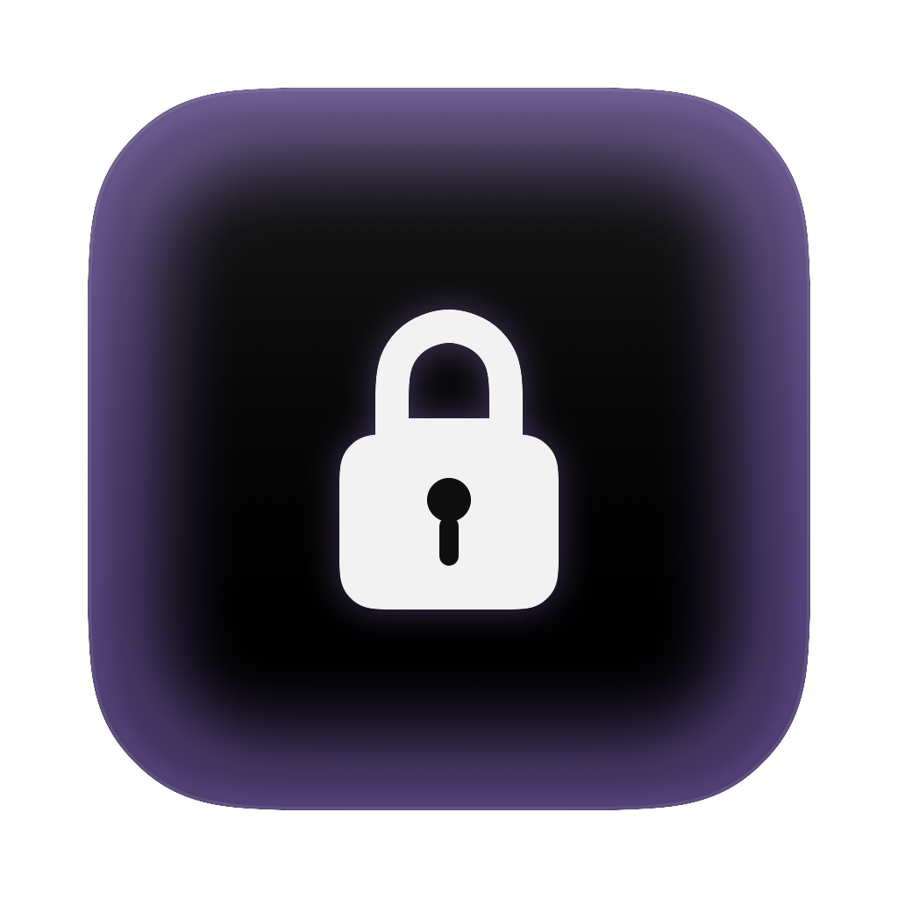
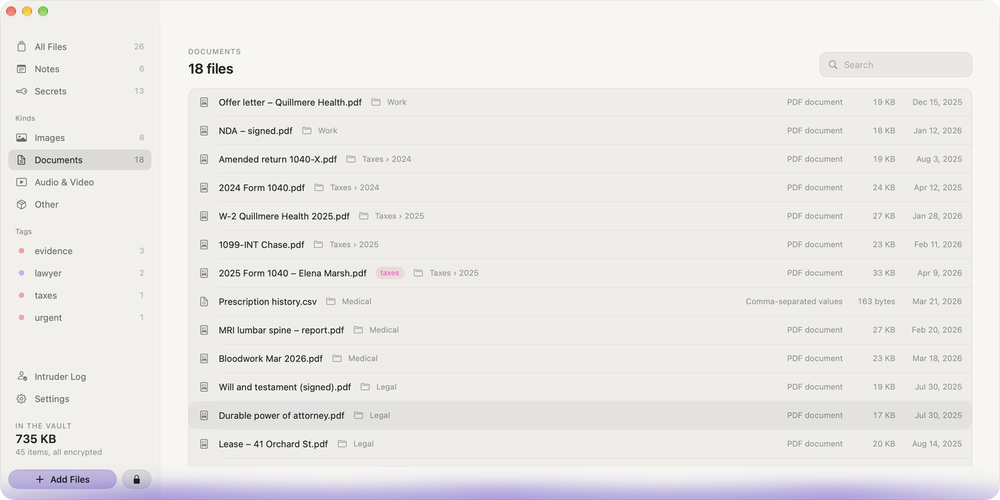
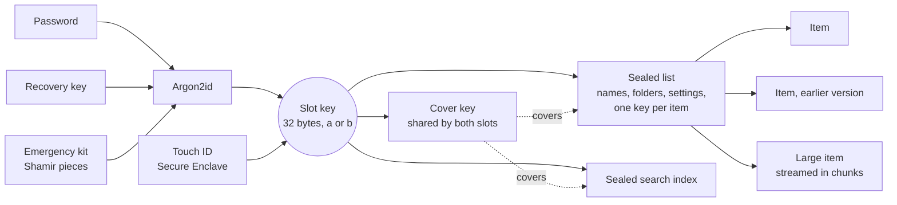

<p align="center">
  
</p>

<h1 align="center">Stillroom Vault</h1>

<p align="center">
  <strong>The encrypted vault for your Mac that never goes online.</strong><br>
  Files, notes and secrets, sealed on your Mac. No server, no account, no sync.
</p>

<p align="center">
  
  
  
  
  
  
  
</p>

<p align="center">
  <a href="https://www.stillroomvault.com/download/"><strong>Download for Mac</strong></a> ·
  <a href="https://www.stillroomvault.com">Website</a> ·
  <a href="https://www.stillroomvault.com/tools/">Free tools</a> ·
  <a href="docs/SECURITY.md">Security model</a> ·
  <a href="docs/FORMAT.md">File format</a>
</p>

<p align="center">
  
</p>

---

Stillroom keeps what you'd lock in a drawer: scans of documents, contracts, photos, passwords, two-factor setups, private notes. Everything is sealed with AES-256-GCM under keys only you hold, in one folder on your Mac. It makes no network connections: a build check fails any binary that links networking code, and a test proves even the email viewer loads nothing remote.

If you forget your password and lose your recovery key and kit, no one can open it, not even its maker. That's the point.

**At a glance**

| | |
|---|---|
| **Never online** | No server, no account, no sync, no update checks. A build check fails any binary that links networking code. |
| **Keys only you hold** | AES-256-GCM with a fresh key for every item; your password stretched with Argon2id (512 MB, 3 passes). |
| **Ways back in** | A recovery key, a printed emergency kit (Shamir pieces), Touch ID, and an optional lock to this Mac. |
| **Never locked in** | Export plain files any time. The format is public, and [`tools/stillroom-open.py`](tools/stillroom-open.py) opens a vault without the app. |
| **Fair pricing** | Free for 25 items with every feature; $39 once for one person, $129 once for a family of five. |

Stillroom is made by Gjin Prelvukaj and Lis Shala. Questions: hello@stillroomvault.com. Security problems: report them [privately](https://github.com/GjinPrelvukaj/stillroom-vault/security/advisories/new) or to security@stillroomvault.com, never in a public issue.

## Contents

- [Features](#features)
- [Security model](#security-model)
- [How it works](#how-it-works)
- [Building](#building)
- [Testing](#testing)
- [Project layout](#project-layout)
- [Documentation](#documentation)
- [Status and roadmap](#status-and-roadmap)
- [License](#license)

## Features

**Keep anything**
- Files of any kind, plus notes and secrets (password-style records with fields).
- Folders, tags, and earlier versions of every item.
- Search across names and contents, from a word index that is itself sealed.
- Drag files and whole folders in. Once each copy is read back and checked by SHA-256, Stillroom can delete the originals.
- Import from Apple Passwords, and scan documents with your iPhone.

**View without unsealing to disk**
- Built-in viewers for PDFs, images, sketches, text and email (`.eml`/`.emlx`), with Quick Look for everything else.
- Audio and video play straight from the sealed file, streamed in chunks.
- Edit in Place opens documents in their own app from a RAM disk, then seals the changes back.
- Live two-factor codes (RFC 6238) under any secret holding an `otpauth` link or setup key.

**Ways in**
- Password, stretched with Argon2id (512 MB, 3 passes, 4 lanes).
- Recovery key, made with the vault.
- Emergency kit: Shamir pieces you print and hand out, so that any agreed number of them opens the vault.
- Touch ID, through a Secure Enclave key.
- Lock to this Mac: an outer Secure Enclave seal, so the password alone opens the vault only on this Mac.

**Stay shut**
- Auto-lock, locking on sleep, and <kbd>⌃</kbd><kbd>⌥</kbd><kbd>⌘</kbd><kbd>L</kbd> to lock and hide from any app, or from the menu bar.
- Every window is hidden from screen capture, and secure keyboard input is on while Stillroom is in front.
- A decoy password that opens a second, harmless vault with its own recovery key, kit and intruder log. On disk the two slots are built alike and nothing marks which one is yours.
- An intruder log: wrong tries, and optionally a photo, sealed so that only an open vault can read them. It never keeps what was typed.

**Never locked in**
- Export everything as plain files.
- Encrypted backups to one file you keep. Restore unpacks beside the vault and swaps it in with a single atomic rename, so a crash midway never leaves you without a vault.
- [The format is public](docs/FORMAT.md), and [`tools/stillroom-open.py`](tools/stillroom-open.py) reads a vault in about 300 lines of Python, without the app.

## Security model

**Stillroom protects against:**
- a stolen or borrowed Mac
- a copied vault folder
- anyone taking the app apart: there's no secret in the binary, and the format is public
- tampering: every byte is authenticated, and every seal is bound to what it is, so no sealed file can stand in for another
- other accounts on the Mac
- screen recording
- keyloggers that use event taps

**It does not protect against:**
- a weak password: the strength check refuses guessable ones, but the password is still the boundary
- malware with admin rights while the vault is open
- copies another app keeps after Edit in Place: the app warns about this

**The decoy fools someone at the keyboard or with a copy of the folder, not someone who has one password and a copy.** That person can see the other vault holds something, though not what. Copies taken at different times also show when a vault's ways in changed. It's protection against thieves and abusers, not police. [`docs/SECURITY.md`](docs/SECURITY.md) rule 2 says exactly what it does and doesn't do; the file also has the eleven rules the design rests on, and what still shows on disk.

## How it works



- The folder holds two slots, `a` and `b`, built alike. Every way in to a slot (password, recovery key, kit, Touch ID) seals that slot's 32-byte key, which seals its list, its search index and the cover key.
- Each list and index sits inside a cover sealed with the cover key. Every save rewrites both slots' covers, at one size and with one date, so a copy of the folder can't tell which vault changed. Both slots' items share one `Files/` folder.
- **Every sealing of every item gets its own fresh 256-bit key** ("item keys"), kept in the sealed list. Each seal is bound with authenticated data to what it is, so swapping, reordering or replaying sealed files fails to open.
- Items over 8 MB, and all audio and video, use a chunked format (VLT2) that the player reads in ranges.
- Passwords are stretched by the unchanged Argon2 reference C ([`macos/Sources/CArgon2`](macos/Sources/CArgon2/README.md)). An independent Swift implementation is kept in the tests as a cross-check.
- Sizes are padded (Padmé), so a file's size shows only to within about 12%.
- AES-256-GCM comes from Apple CryptoKit. There are no third-party dependencies beyond the Argon2 reference code.

The full byte-level layout is in [`docs/FORMAT.md`](docs/FORMAT.md).

## Building

Requires an Apple silicon Mac with macOS 26 or later and Xcode 26 (Swift 6). It's a Swift package, with no Xcode project.

Run these from `macos/`.

```bash
swift build                      # debug build
Scripts/make-app.sh debug        # build/Stillroom.app, signed for development
Scripts/make-dist.sh             # Developer ID signed, notarized and stapled app and zip
```

Every app build runs [`macos/Scripts/check-offline.sh`](macos/Scripts/check-offline.sh), which fails it if the binary links networking frameworks or calls socket, DNS or URL-loading APIs.

> [!WARNING]
> Never point a development build at a real vault. Tests redirect the store to a temporary folder. To try a build on screen, copy `build/Stillroom.app`, give the copy its own bundle id (and sign it again), and run it with `CFFIXED_USER_HOME=<scratch folder>`, so its vault, caches and logs land there.

## Testing

```bash
swift test                                   # the whole suite, about 15 s (Argon2 is turned down in tests)
swift test --filter EmergencyKitTests        # one suite
swift test --filter kitPiecesOpenTheVault    # one test
PYTHON=<python with cryptography and argon2-cffi> ../tools/test-stillroom-open.sh   # the Python reader against a vault the app writes
```

The suite covers the vault flows end to end, plus:
- **Format binding:** older versions and other files can't be passed off as the current one.
- **Decoy shape:** an unset decoy is shaped exactly like a set, empty one.
- **Hostile email:** an email aimed at a local server must cause zero connections.
- **Argon2:** the reference C is checked against RFC 9106 and libargon2's known answers.
- **Atomic restore:** a restore cut short at each step still leaves a whole vault.

## Project layout

```
macos/               the Mac app (Swift package)
  Package.swift
  Sources/
    Stillroom/
      AppState.swift   the one source of truth: open vault, list, every action
      Storage/         VaultStore, chunked format, RAM disk, backups, search index, verified deletion
      Crypto/          sealing, Argon2, emergency kit, Touch ID, Lock to this Mac, two-factor codes
      Security/        activity log, intruder log and camera, password strength, lock hot key
      Views/           lock screen, vault, viewers, editors, settings, sheets
      Design/          the design kit
      Models/          items, secrets, email, password import
    CArgon2/           Argon2 reference C, unchanged
  Tests/StillroomTests/
  Scripts/             app, distribution, icon and offline-check scripts
windows/             the Windows port
tools/               stillroom-open.py, the independent reader, and its check
docs/                security rules and the file format
```

## Documentation

| Document | What's in it |
|---|---|
| [`docs/SECURITY.md`](docs/SECURITY.md) | The threat model, the rules the design rests on, and what still shows on disk |
| [`docs/FORMAT.md`](docs/FORMAT.md) | Every file in a vault, exactly enough to read one without the app |
| [`CHANGELOG.md`](CHANGELOG.md) | What changed, by version |

## Status and roadmap

**1.0.0 is out** (28 October 2026): download it from [stillroomvault.com](https://www.stillroomvault.com/download/). Format 4 is the 1.0 format, and every later version must open a vault 1.0 wrote (`OneZeroFixtureTests`). An independent, named security review is next.

- **1.0:** sold directly for $39 one-time (Family $129 for five people, Teams upon request) with an offline-signed license key, plus a free tier of 25 items that never blocks opening, exporting or backing up.
- **1.x:** key rotation; a kit id in emergency-kit pieces.
- **2.0:** optional sync through a folder you choose, carrying only sealed files.

## License

Copyright © 2026 Gjin Prelvukaj and Lis Shala. The source is available under the [Functional Source License 1.1](LICENSE.md) (FSL-1.1-ALv2): read it, audit it, build it and change it for your own use, but don't sell it as a competing product. Each version becomes Apache 2.0 two years after it's released.

[`tools/`](tools/LICENSE.md), the reader that opens a vault without the app, is MIT: anyone may use it for anything.

`macos/Sources/CArgon2` is the Argon2 reference implementation, licensed under CC0 1.0 or Apache 2.0 ([`macos/Sources/CArgon2/LICENSE`](macos/Sources/CArgon2/LICENSE)).
